# Dock Pilot

**[English](#english) · [Deutsch](#deutsch)**

<table>
  <tr>
    <td>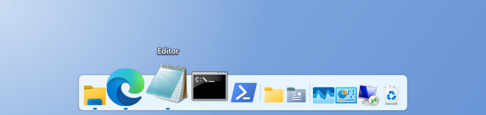</td>
    <td>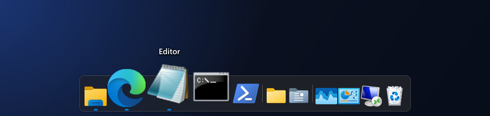</td>
  </tr>
  <tr>
    <td align="center">Light · Hell</td>
    <td align="center">Dark · Dunkel</td>
  </tr>
</table>

Author / Autor: Günther Schoder · [www.westmc002.de](https://www.westmc002.de)

---

## English

A program launcher bar at the edge of the screen – a modern successor to the classic RocketDock for Windows 10 and 11. Programs, files, folders, websites and folder menus are one click away; the icons grow smoothly under the mouse.

The program interface is in German.

### Features

- **Dock at any screen edge** (top, bottom, left, right) on any monitor, sharp at every display scaling
- **Zoom effects:** bubble (optionally without widening the bar), soft bubble, fixed, lift, glow, focus, bounce or none; if the dock doesn't fit on the screen, icons shrink automatically
- **Running programs** are marked; a click brings the window to the front like the taskbar (Shift+click or middle-click starts a new instance)
- **Window previews** like the taskbar: hover over a running program to see live thumbnails of its windows, click to switch, × to close
- **Customizable look:** labels (font, size, bold, color, shadow), reflection, bar opacity and corner radius or icons only
- **Folder menus:** a folder opens as a menu with submenus – ideal for collections of shortcuts (replaces the KkMenu docklet)
- **Drag & drop:** drag programs, shortcuts, files and folders from Explorer into the dock; drop files onto a program to open them with it; rearrange icons by dragging
- **Auto-hide** with adjustable delays, **hidden while a full-screen program runs** (games, videos), **hotkey** to show and hide
- **Windows 11 look:** background like an active window (Mica), light/dark mode, Windows accent color, menus in Windows 11 style
- **Import from RocketDock:** entries, separators, folder menus, custom icons, sizes, position, auto-hide and hotkey from RocketDock's `Settings.ini`
- **Backup:** save entries, settings and icons to one file and restore them, e.g. on a second PC
- **Updates:** checks GitHub for a new version at startup (at most every 20 hours) and updates itself with one click – settings are kept
- **No installation:** extract and start – settings are stored in `%LOCALAPPDATA%\Dock Pilot`

### Installation

1. Download the ZIP `Dock-Pilot-<version>.zip` from the [Releases](https://github.com/WestMc002/Dock-Pilot/releases).
2. Extract it into a folder of its own with write access (e.g. `C:\Tools\Dock Pilot`) and start `Dock Pilot.exe` – no installation required.
3. If RocketDock is installed, Dock Pilot offers to import its entries on the first start. Afterwards close RocketDock and remove it from autostart.
4. Optional: enable “Mit Windows starten” (start with Windows) in the settings.

Requirements: Windows 10 or 11 with .NET Framework 4.x (included in Windows).

### Building from source

Run `Erstellen.bat` in the project folder. It

- compiles with the C# compiler of .NET Framework 4 (no other software needed),
- assigns the version number automatically (Major.Minor.Year.MonthDay),
- keeps the previous EXE and backs up the project to `Backup`,
- optionally creates the screenshots for this page (`"Dock Pilot.exe" --screenshots`, sample data only),
- starts the new Dock Pilot.

---

## Deutsch

Programmleiste am Bildschirmrand – ein moderner Nachfolger des bekannten RocketDock für Windows 10 und 11. Programme, Dateien, Ordner, Webseiten und Ordnermenüs sind einen Klick entfernt; unter der Maus werden die Symbole fließend größer.

### Funktionen

- **Dock an jedem Bildschirmrand** (oben, unten, links, rechts) auf jedem Bildschirm, scharf bei jeder Skalierung
- **Zoom-Effekte:** Blase (auf Wunsch, ohne dass die Leiste breiter wird), weiche Blase, fest, anheben, leuchten, Fokus, federn oder aus; passt das Dock nicht auf den Bildschirm, werden die Symbole automatisch kleiner
- **Laufende Programme** werden markiert; ein Klick holt das Fenster nach vorne wie in der Taskleiste (Umschalt + Klick oder Mittelklick startet neu)
- **Fenstervorschau** wie in der Taskleiste: Maus auf ein laufendes Programm zeigt Live-Vorschaubilder seiner Fenster, Klick wechselt dorthin, × schließt
- **Aussehen einstellbar:** Beschriftung (Schriftart, Größe, fett, Farbe, Schatten), Spiegelung, Deckkraft und Eckenradius der Leiste oder nur Symbole
- **Ordnermenüs:** ein Ordner öffnet sich als Menü mit Untermenüs – ideal für Sammlungen von Verknüpfungen (Ersatz für das KkMenu-Docklet)
- **Ziehen und Ablegen:** Programme, Verknüpfungen, Dateien und Ordner aus dem Explorer ins Dock ziehen; Dateien auf ein Programm ziehen öffnet sie damit; Reihenfolge per Ziehen ändern
- **Automatisch ausblenden** mit einstellbarer Verzögerung, **verborgen bei Vollbild-Programmen** (Spiele, Videos), **Tastenkürzel** zum Ein- und Ausblenden
- **Windows-11-Design:** Hintergrund wie ein aktives Fenster (Mica), Hell/Dunkel, Windows-Akzentfarbe, Menüs im Windows-11-Stil
- **RocketDock übernehmen:** Einträge, Trennlinien, Ordnermenüs, eigene Symbole, Größen, Position, automatisches Ausblenden und Tastenkürzel aus der `Settings.ini` von RocketDock
- **Sicherung:** Einträge, Einstellungen und Symbole in eine Datei sichern und wiederherstellen, z. B. auf einem zweiten PC
- **Updates:** sieht beim Start (höchstens alle 20 Stunden) auf GitHub nach einer neuen Version und aktualisiert sich auf Klick selbst – die Einstellungen bleiben erhalten
- **Ohne Installation:** entpacken und starten – die Einstellungen liegen in `%LOCALAPPDATA%\Dock Pilot`

Die ausführliche Anleitung steht in [Anleitung.txt](Anleitung.txt).

### Installation

1. Das ZIP `Dock-Pilot-<Version>.zip` aus den [Releases](https://github.com/WestMc002/Dock-Pilot/releases) herunterladen.
2. In einen eigenen Ordner mit Schreibrechten entpacken (z. B. `C:\Tools\Dock Pilot`) und `Dock Pilot.exe` starten – keine Installation nötig.
3. Ist RocketDock installiert, bietet Dock Pilot beim ersten Start an, dessen Einträge zu übernehmen. Danach RocketDock beenden und aus dem Autostart nehmen.
4. Optional: in den Einstellungen „Mit Windows starten“ einschalten.

Voraussetzungen: Windows 10 oder 11 mit .NET Framework 4.x (in Windows enthalten).

### Selbst kompilieren

`Erstellen.bat` im Projektordner starten. Sie

- kompiliert mit dem C#-Compiler des .NET Framework 4 (keine weitere Software nötig),
- vergibt die Versionsnummer automatisch (Haupt.Neben.Jahr.MonatTag),
- bewahrt die bisherige EXE auf und sichert das Projekt unter `Backup`,
- erstellt auf Wunsch die Screenshots für diese Seite (`"Dock Pilot.exe" --screenshots`, nur Beispieldaten),
- startet das neue Dock Pilot.

---

## Screenshots

<table>
  <tr>
    <td>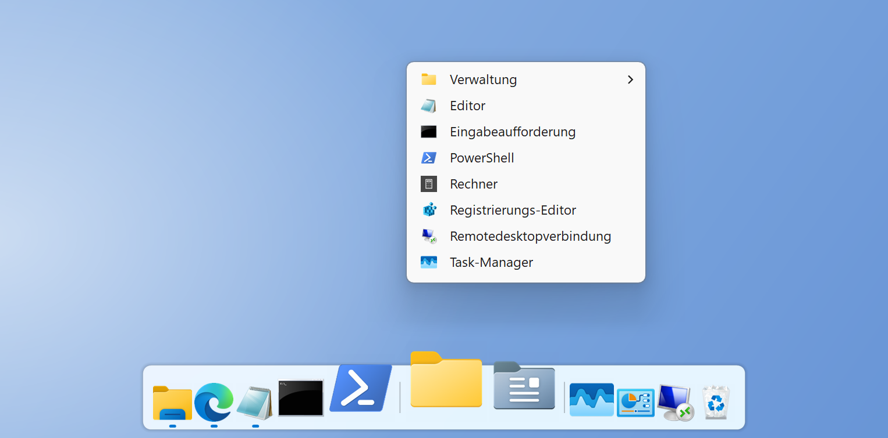</td>
    <td>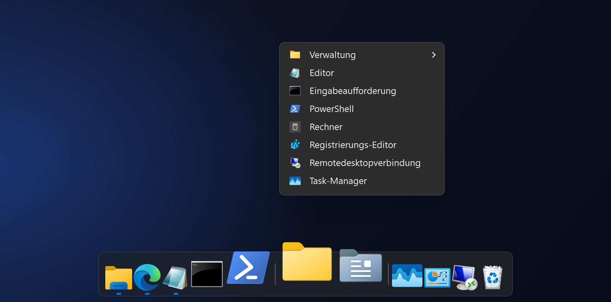</td>
  </tr>
  <tr><td colspan="2" align="center">Folder menu · Ordnermenü</td></tr>
  <tr>
    <td>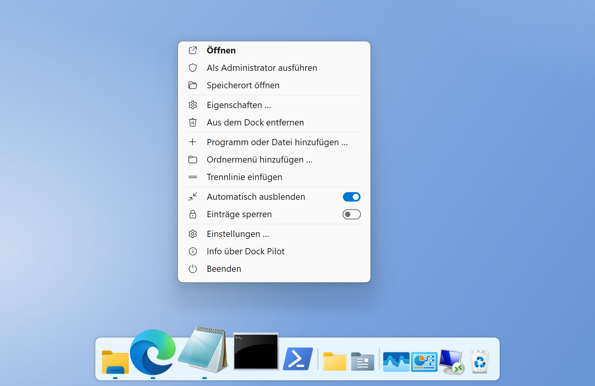</td>
    <td>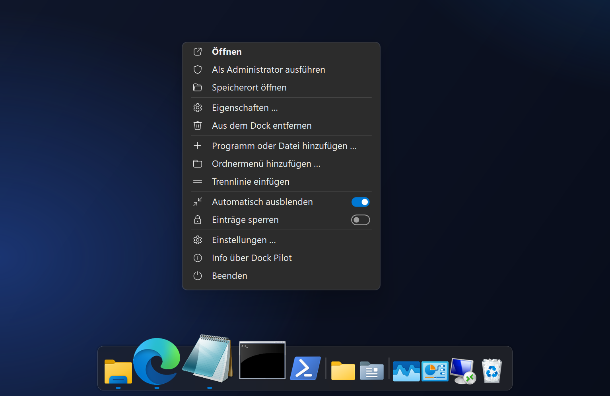</td>
  </tr>
  <tr><td colspan="2" align="center">Right-click on an entry · Rechtsklick auf einen Eintrag</td></tr>
  <tr>
    <td>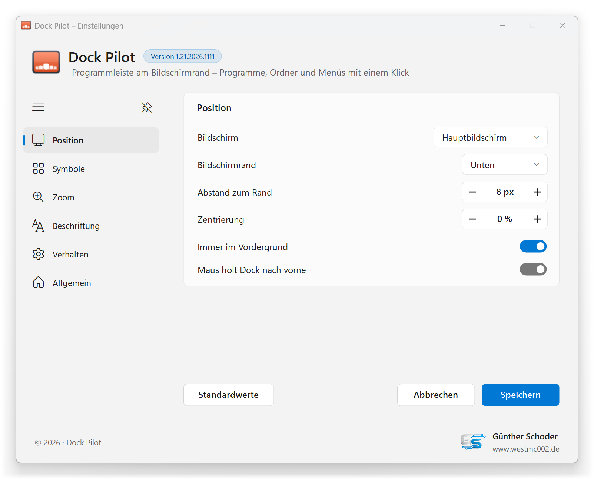</td>
    <td>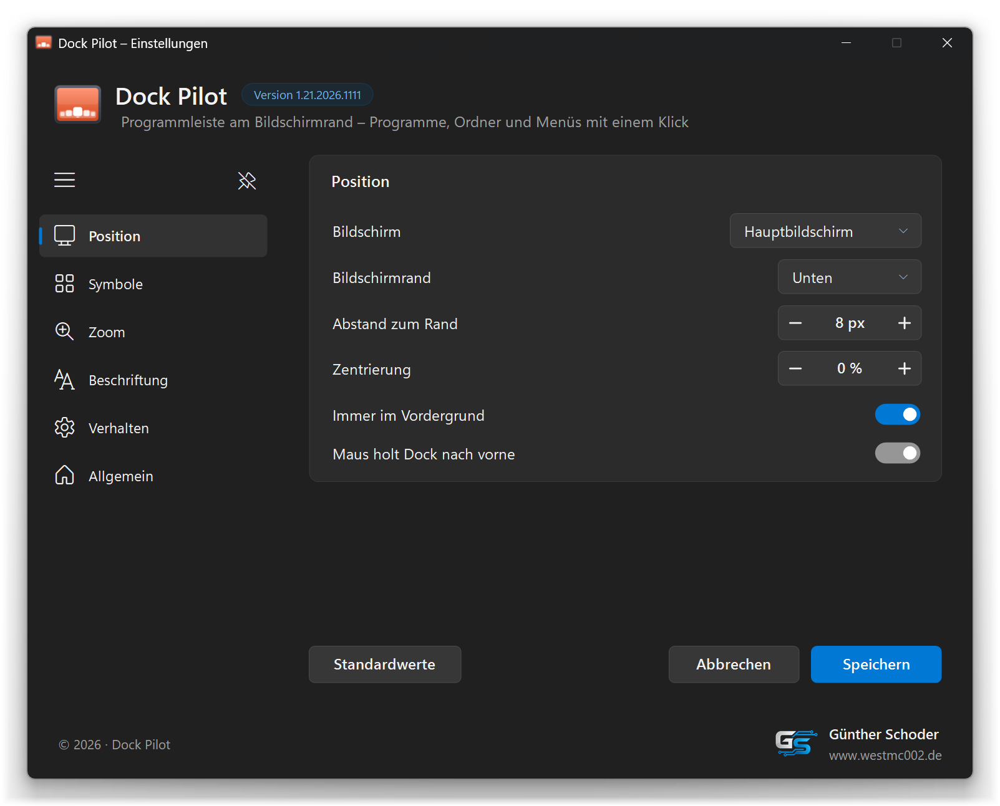</td>
  </tr>
  <tr><td colspan="2" align="center">Settings · Einstellungen</td></tr>
  <tr>
    <td>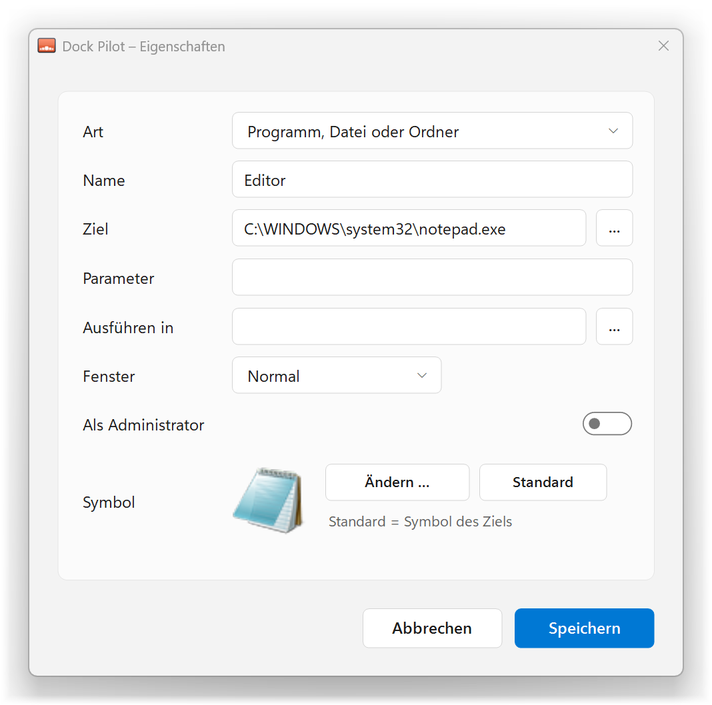</td>
    <td>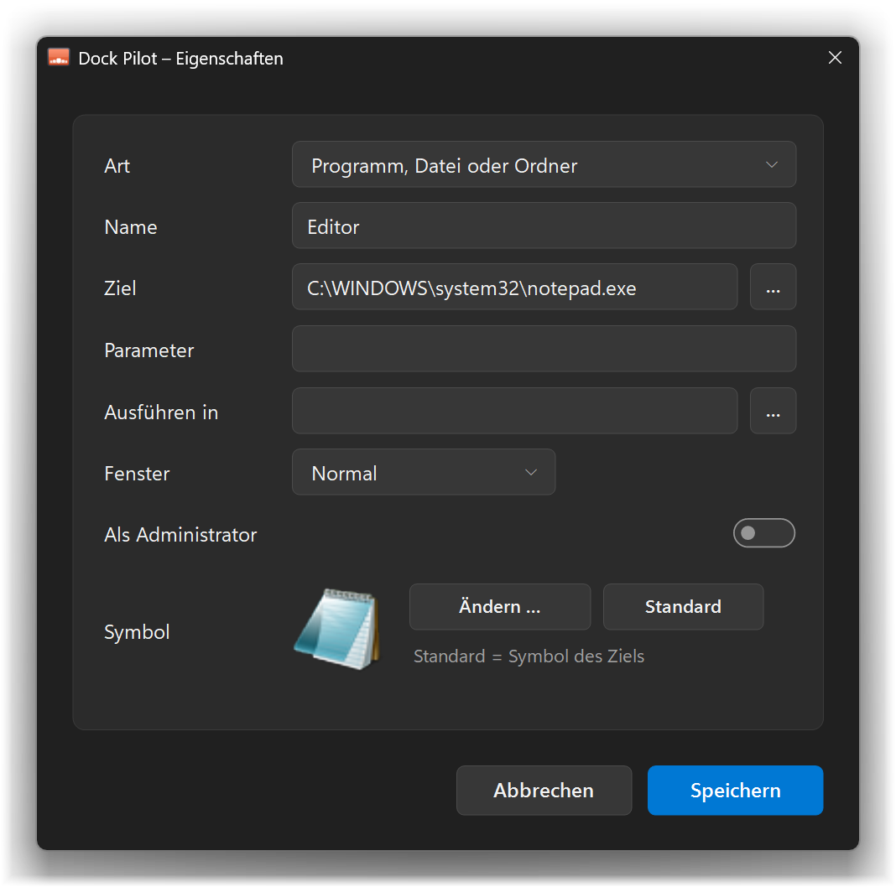</td>
  </tr>
  <tr><td colspan="2" align="center">Properties of an entry · Eigenschaften eines Eintrags</td></tr>
  <tr>
    <td>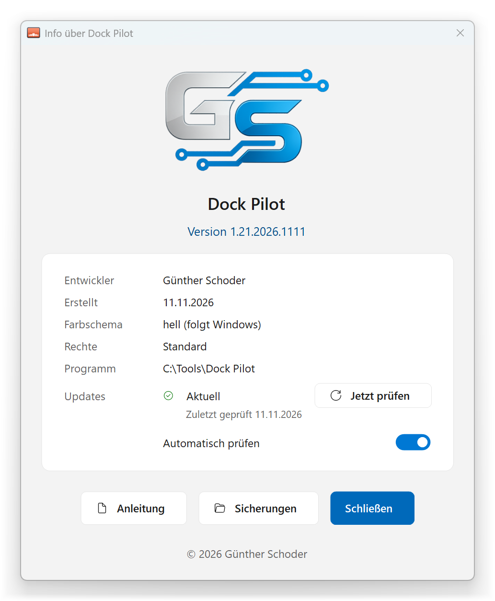</td>
    <td>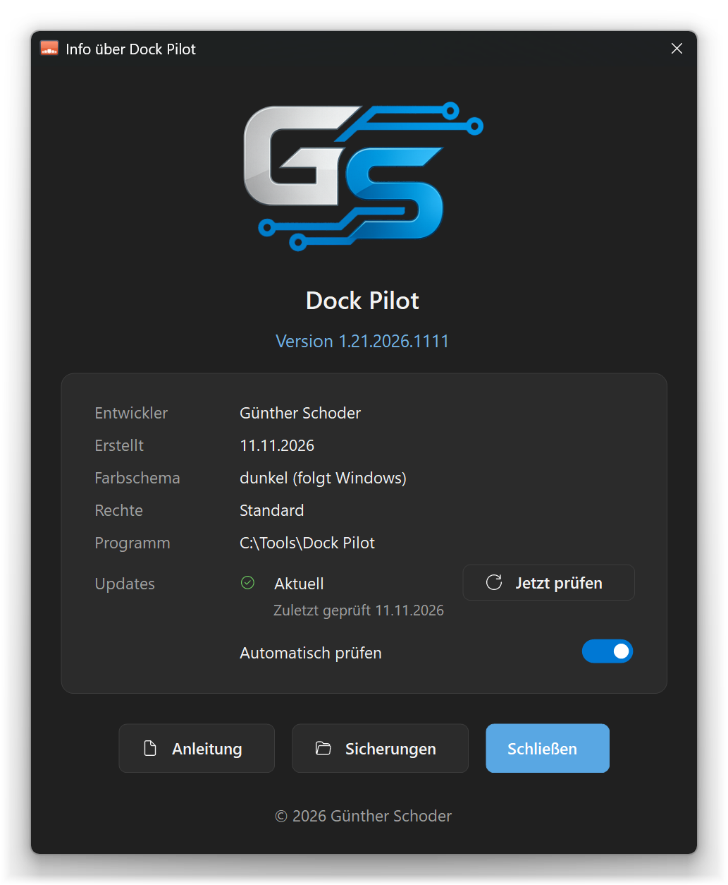</td>
  </tr>
  <tr><td colspan="2" align="center">About Dock Pilot · Info über Dock Pilot</td></tr>
</table>

## Project structure / Projektaufbau

| Folder / file · Ordner / Datei | Content · Inhalt |
|---|---|
| `Quellcode` | C# source code and manifest · C#-Quellcode und Manifest |
| `Resources` | embedded resources (icon, logo) · eingebettete Ressourcen (Icon, Logo) |
| `Screenshots` | images for this page · Bilder für diese Seite |
| `Erstellen.bat` | build script · Build-Skript |
| `Anleitung.txt` | manual (German) · Anleitung (Deutsch) |

## License / Lizenz

GNU General Public License v3.0 or later · GNU General Public License v3.0 oder später – [LICENSE](LICENSE).

© 2026 Günther Schoder

**Exception / Ausnahme:** The GS logo (`Resources/GS-Logo.png`) is excluded from the GPL. All rights reserved; it may only be redistributed unchanged together with this program. · Das GS-Logo (`Resources/GS-Logo.png`) ist von der GPL ausgenommen. Alle Rechte vorbehalten; es darf nur zusammen mit diesem Programm in unveränderter Form weitergegeben werden.

This project is an independent successor inspired by RocketDock (Punk Software). It contains no code from it and is not affiliated with Punk Software; RocketDock is a name of Punk Software. Dock Pilot can import RocketDock's settings file. · Dieses Projekt ist ein unabhängiger Nachfolger, angeregt durch RocketDock (Punk Software). Es enthält keinen Code daraus und ist nicht mit Punk Software verbunden; RocketDock ist ein Name von Punk Software. Dock Pilot kann die Einstellungsdatei von RocketDock übernehmen.

This project is not affiliated with or endorsed by Microsoft; Windows is a trademark of Microsoft Corporation. · Dieses Projekt ist nicht mit Microsoft verbunden und wird nicht von Microsoft unterstützt; Windows ist eine Marke der Microsoft Corporation.
